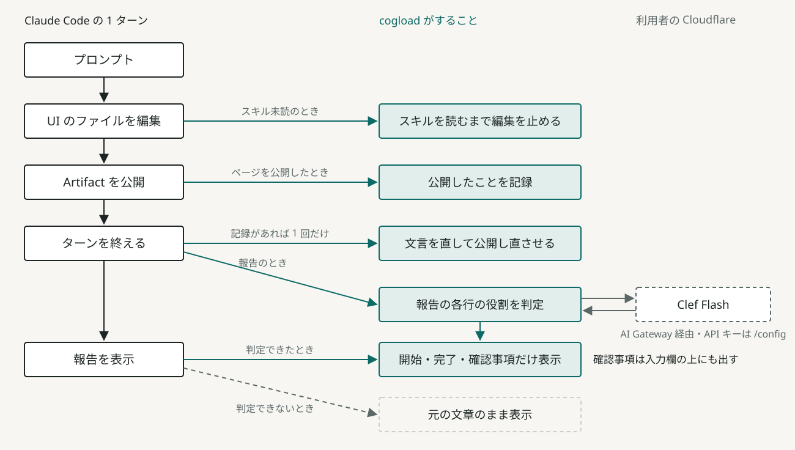
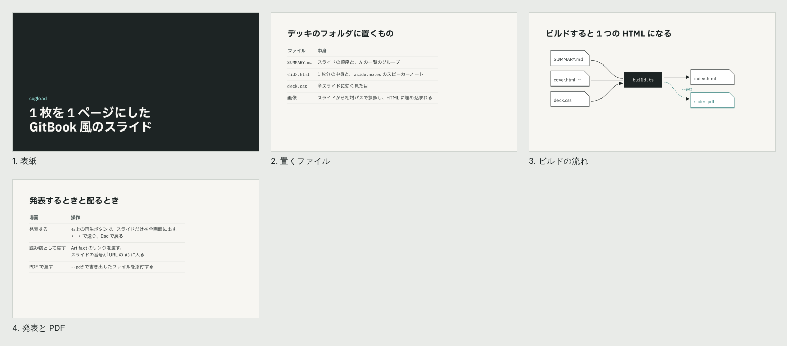
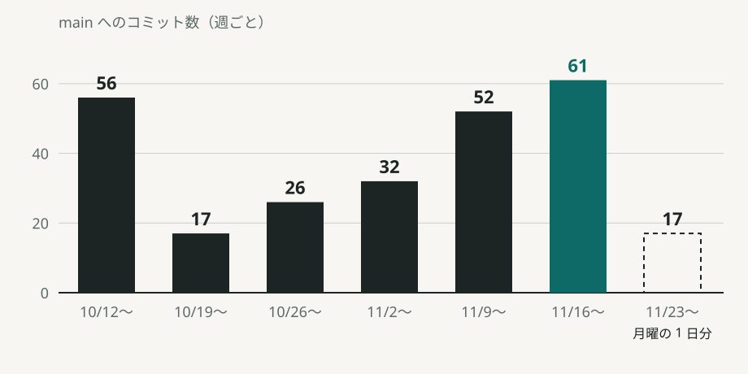

# cogload

Claude Code の持ち主が読む量、覚えておく量、手で打つ量を減らす。

- 作業報告を、ターンが終わった時点で開始状態、完了状態、確認事項だけの表示に描き直す。書いている途中は全文が流れる。確認事項は末尾に置き、入力欄の上にも出す。省いた行は「全文」ボタンで開ける。Claude 側の記録は元の文章のまま残る
- UI のファイルや HTML の資料を書く前に、対応するスキルを Claude に読ませる。読むまで編集を止める
- Artifact のページを公開したターンの終わりに、Claude に `stop-describing-ui` を読ませ、公開したページの説明的な文言を直して公開し直させる。直したあとのターンは止めない
- 報告と資料の書き方を決める [cognitive-load](skills/cognitive-load/SKILL.md) と、Markdown から GitBook 風の複数ページ資料を作る [gitbook-pages](skills/gitbook-pages/SKILL.md) を同梱する

## 1 ターンの中で cogload がすること

## 使い方

`/plugin install cogload@masseater` でインストールする。

報告を短くする判定には、Cloudflare Workers AI の判定モデル Clef Flash を AI Gateway 経由で使う。インストールの後、`/config` で cogload の次の 3 つを設定する。

| 項目 | 値 |
| --- | --- |
| `cloudflare_account_id` | Cloudflare のアカウント ID |
| `cloudflare_api_token` | Workers AI Read と AI Gateway Run の権限を持つ API トークン（安全な保存先に入る） |
| `cloudflare_ai_gateway` | 使う AI Gateway の名前。既定は `default` |

3 つを設定しないときは、masseater の MCP ポータルに接続している環境に限り、ポータルの `sundries` の `decide` ツールが同じ判定を行う。設定が要らず、認証はポータルへのログインだけで足りる。

設定もポータルも使えないとき、呼び出しに失敗したとき、判定モデルが報告だと言い切らなかったときは、報告を元の文章のまま表示する。判定モデルは行を選ぶだけで、文章は書き換えない。

読ませるスキルを増やすには、`hooks/skill-first.ts` の `RULES` に、ファイルパスの条件とスキル名の組を足す。

## 見本

### スライド

[gitbook-slides](skills/gitbook-slides/SKILL.md) で組み立てられるデッキの見本。画像は全スライドを並べたもの。

| デッキ | 中身 |
| --- | --- |
| [basic](skills/gitbook-slides/examples/basic/) | 表紙、表、図のスライドと、スピーカーノートの書き方 |

### インフォグラフィック

[infographic](skills/infographic/SKILL.md) の描き方の系統ごとの見本。

| 系統 | 見本 |
| --- | --- |
| アイソタイプ |  |
| 模式図 |  |
| 注記付きの図解 |  |
| エディトリアルのデータ図 |  |

図で表すものと文字で書くものの良い例と悪い例は [figure-or-text.md](skills/infographic/references/figure-or-text.md) にある。
