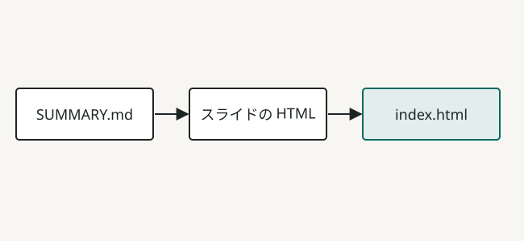
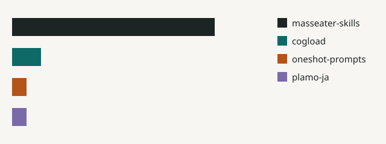
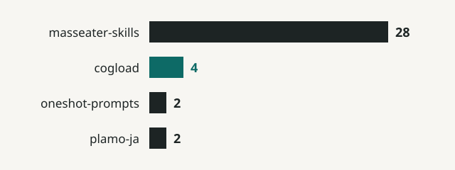
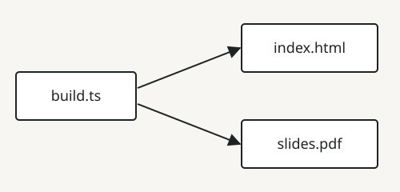

# 図で表すものと文字で書くもの

図に任せるのは、見る人が目で比べればつかめる関係である。文字で書くのは、目で比べても正確には読み取れない中身である。

| 図で表す | 図の中に文字で書く | 図の外の本文に書く |
| --- | --- | --- |
| 関係、流れ、依存、段階、時間、量、状態。矢印、路線、漏斗、ゲージ、時間軸、枠の埋まり具合で描く | 名前、正確な数と単位、条件、経緯、金額、期限、担当、判断の材料 | 理由、背景、結論の文 |

## 文を語と数字と短い句に縮める

- 「先方からの返事を待っている状態です」ではなく「先方の返事待ち」と書く。
- 「見積もりは 50 万円ほどで、来週中に確定する見込み」ではなく「見積もり 約 50 万円 → 来週確定」と書く。値と次に起きることは、矢印でつなぐ。
- 「利用者が質問を送り、サポートが回答する」は文にせず、利用者からサポートへ矢印を引いて「質問」と書き、戻りの矢印に「回答」と書く。動きを表す文は、矢印と矢印の言葉になる。

## 同じ種類の要素は、矢印の上か相手のそばに置く

サービス、施策、メンバー、拠点、案件のように同じ種類の要素が複数あるとき、横一列に並べると、見る人にはどれが何に関わるかが分からない。次の順で置き場所を決める。

1. 要素ごとに「何（誰）から → 何を → 何（誰）へ」を決める。
2. 要素を、その矢印の上か、関わる相手のすぐそばに置く。
3. 関わる相手も渡すものも同じ要素どうしだけ、まとめて置いてよい。
4. 1 が決められない要素は、図に要るかを考え直す。

要素をすべてカードの横並びに置き換えても意味が変わらないなら、置き場所が決まっていない。たとえば担当者を並べず、各人を、持っている工程のそばに置く。

## 順序は矢印で表す

| 悪い例 | 良い例 |
| --- | --- |
|  |  |

悪い例は「まず」「次に」「最後に」で順序を文に書いている。見る人は箱を文章として上から読むので、図の意味がない。良い例は矢印が順序を持ち、箱には名前だけがある。各段階の説明が要るなら、本文に書く。

## 正確な値と名前は文字で添える

| 悪い例 | 良い例 |
| --- | --- |
|  |  |

悪い例は、2 と 4 の差を棒の長さでしか読めず、どの棒が何かを凡例と色で往復させる。良い例は、大小を棒で見せ、正確な数と名前を棒の横に書く。

## 条件は線の描き方と文字の両方で示す

| 悪い例 | 良い例 |
| --- | --- |
|  |  |

悪い例は、いつも出る出力と、オプションを付けたときだけ出る出力を同じ線で描いている。見る人は両方がいつも出ると読む。良い例は、条件付きの流れを点線にして違いを見せ、どんな条件かを線の横に文字で書く。点線だけでは、何の条件かが読めない。
