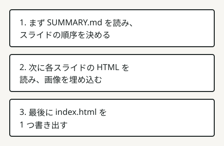
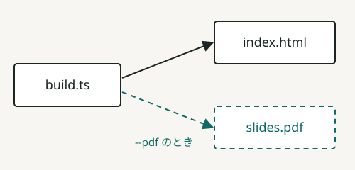

# 図で表すものと文字で書くもの

図に任せるのは、読み手が目で比べればつかめる関係である。文字で書くのは、目で比べても正確には読み取れないものである。どちらかに寄せすぎると、読み手は図と本文を往復することになる。

| 図で表す | 図の中に文字で書く | 図の外の本文に書く |
| --- | --- | --- |
| 順序、流れ、包含、分岐、大小、位置 | 名前、正確な数と単位、条件、指している部分 | 理由、背景、結論の文 |

## 順序は矢印で表す

| 悪い例 | 良い例 |
| --- | --- |
|  |  |

悪い例は「まず」「次に」「最後に」で順序を文に書いている。読み手は箱を文章として上から読むので、図の意味がない。良い例は矢印が順序を持ち、箱には名前だけがある。各段階の説明が要るなら、本文に書く。

## 正確な値と名前は文字で添える

| 悪い例 | 良い例 |
| --- | --- |
|  |  |

悪い例は、2 と 4 の差を棒の長さでしか読めず、どの棒が何かを凡例と色で往復させる。良い例は、大小を棒で見せ、正確な数と名前を棒の横に書く。色は強調したい 1 本だけに使う。

## 条件は線の描き方と文字の両方で示す

| 悪い例 | 良い例 |
| --- | --- |
|  |  |

悪い例は、いつも出る出力と、オプションを付けたときだけ出る出力を同じ線で描いている。読み手は両方がいつも出ると読む。良い例は、条件付きの流れを点線にして違いを見せ、どんな条件かを線の横に文字で書く。点線だけでは、何の条件かが読めない。
